<div align="center">

# ⚔️ ARLI OF THE CODE REALM

### 🏰 The Dark Fantasy Profile of a Computer Engineering Student


<br>


<br><br>



</div>

---

## 🕯️ The Chronicle

> In a realm of logic and machines, there walks **Arli**,  
> a student of **Computer Engineering**,  
> forging knowledge through code, systems, and relentless practice.

I am **Arli**, an **S1 Teknik Komputer** student who is learning to master the foundations of computing.  
My current weapon of choice is **C programming**, and my world is shaped by **Linux** and **computer systems**.

---

## 🛡️ Character Sheet

```text
╔══════════════════════════════════════════════════════════╗
║                    CHARACTER PROFILE                    ║
╠══════════════════════════════════════════════════════════╣
║ NAME       : Arli                                       ║
║ TITLE      : The Code Knight                            ║
║ GUILD      : Computer Engineering                       ║
║ CLASS      : C Programmer                               ║
║ REALM      : Linux Kingdom                              ║
║ MISSION    : Learn, Build, Improve                      ║
║ STATUS     : On an Endless Quest                        ║
╚══════════════════════════════════════════════════════════╝
